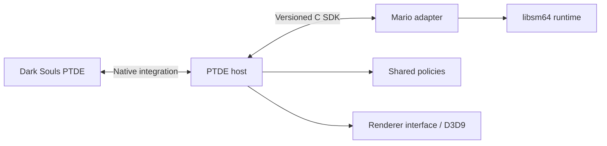

# Character framework

MarioSouls is a working PTDE/Mario integration organized so future native hosts and guest characters can reuse its boundaries. **PTDE/D3D9 and Mario/libsm64 are implemented. Remastered/DX11 and other characters are not.**

This page is an overview. [ARCHITECTURE.md](docs/ARCHITECTURE.md) is the required detailed design for developers/AI agents: dependency rules, authority, runtime phases, failure behavior, extension decisions and current debt. Read it with [AGENTS.md](../AGENTS.md) before changing a boundary; use [CONTRACT.md](docs/CONTRACT.md) for exact ABI semantics.

## Responsibilities

| Layer | Owns | Must not own |
| --- | --- | --- |
| `hosts/ds1ptde/` | Addresses/layouts, hooks, maps, collision, input, menus, native damage/state, D3D9, extraction and installation | Guest action IDs or character-name-specific gameplay branches |
| `core/` | Lifecycle, timing, motion/combat policies, validation and host capability requirements | Native memory/graphics APIs or guest-engine internals |
| `sdk/` | Neutral C adapter contract and internal renderer interface | Native actor pointers, STL containers or allocator ownership across DLLs |
| `characters/mario64/` | libsm64 binding, ROM decoding, movement/action translation, animation and props | Dark Souls memory, inventory, quests, HP/stamina writes |
| `build/` | Compile-only header/ABI checks | A game simulator or behavioral test platform |

Dark Souls remains authoritative for HP, stamina, equipment, inventory, effects, quests, deaths and rewards. Guest simulation requests motion/contacts; the host validates and resolves them through native systems.

## Lifecycle and presentation

Class selection/manual intent, native identity, locomotion ownership and visual presentation are distinct. A saved Mario class can request guest appearance before safe movement ownership is available. Native menus, interactions, recovery, death and cutscenes retain control while the host supplies a validated guest pose where possible.

Movement uses a bounded request/acknowledgement bridge. Native collision/support is reconciled before another guest tick or outgoing contact. Seamless map changes refresh terrain without discarding a still-valid actor/guest binding; true actor replacement invalidates stale requests and targets. A failed replacement draw must not hide the only visible player.

The PTDE host remains one translation unit with explicit include order. `character_state.h` now owns adapter resources and the non-copyable gameplay/presentation session, while neutral mesh storage lives in `core/character_storage.h`. Preview/cinematic/audio and feature-specific hook/lease state still have edition-local owners/statics; the fragments are not independent public modules. See [PTDE source map](hosts/ds1ptde/README.md) and [Mario ownership](characters/mario64/README.md).

## Rendering and time

The internal [renderer interface](sdk/render_api.h) accepts borrowed meshes/textures, camera matrices, depth availability and scene/before-HUD/preview phases. PTDE implements it with D3D9, including DSfix scene/UI/depth handling. No DX11 backend exists.

Character, equipment, cannon, impact flashes, diagnostic lines and screen text/reticles use that boundary. CPU geometry helpers stay in core; D3D9 resources/pipeline state stay in PTDE's backend. Native camera extraction, scene/UI recognition and composition remain edition-specific. Character/camera assembly uses `core/character_presentation.h`; F8 captures neutral observations in PTDE and reuses `core/debug_presentation.h` for shape/panel assembly. See the concrete [presentation-first port handoff](docs/REMASTERED_HANDOFF.md).

Guest simulation targets 30 Hz independently of render cadence. The current PTDE caller consumes at most one tick per update and waits for native motion acknowledgement; low update rates can still slow simulation. Render-only interpolation smooths validated mesh/attachment and native-anchor snapshots without advancing simulation or changing hit detection.

## Host and guest capabilities

Host facilities in `core/host_capabilities.h` are different from adapter `SC_CAP_*` flags. Movement, native combat, interactions, platform support and before-HUD rendering each require verified host facilities. Missing support disables that operation or keeps native behavior; it does not synthesize floors, damage or quest effects.

Adapters opt into implemented abilities and independently versioned profiles. Future Link/DK/other work needs an actual engine/assets adapter, not a host branch or a renamed Mario descriptor. See the [SDK contract](docs/CONTRACT.md) and [adapter guide](docs/ADDING_A_CHARACTER.md).

## Remastered preparation

The code retains portable scalar/pointer types, explicit calling conventions/layout checks, edition-owned assets/configuration and a graphics boundary. `build --check-portability` compiles x86/x64 SDK/core declarations and x64 guest components; PTDE remains x86. These checks prepare a future owned-installation port, not compatibility certification.

Use the [host-porting guide](docs/HOST_PORTING.md) and [PTDE integration inventory](hosts/ds1ptde/PORT_CHECKLIST.md) when rediscovering native behavior for another edition.

`build --host <id>` selects an actually implemented edition's own build/link recipe and target; unknown/unimplemented hosts are refused. PTDE paths remain unchanged; other editions have separate output trees and manifests. Installation remains PTDE-only. The first Remastered milestone is explicitly presentation with native locomotion, not a full gameplay takeover.

## Work and documentation

Build and prepare local data through [development](../docs/DEVELOPMENT.md); install through the single [setup entry point](../docs/INSTALLING.md). Compile-only CI and the [manual checklist](../docs/TESTING.md) have distinct roles.

Update [Features and tweaks](../docs/FEATURES_AND_TWEAKS.md) for behavior/default changes, [CHANGELOG.md](../CHANGELOG.md) for meaningful changes and the affected SDK/porting guide for integration changes. Fork fixes must be pushed to the fork and proposed upstream by PR; see [contributing](../CONTRIBUTING.md).
