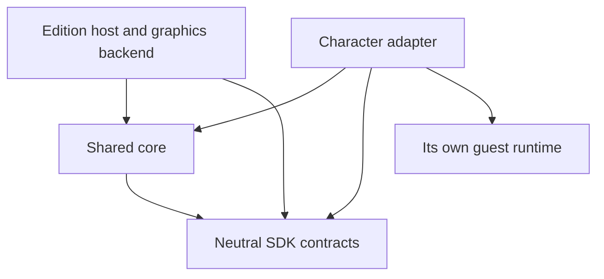

# Intended architecture and dependency rules

This is the maintained design specification for developers and AI agents. It defines where future changes belong and which boundaries must hold. It does not claim that every internal module has already been separated or that another host/character works.

**Implemented:** Windows/x86 PTDE host, D3D9/DSfix integration and the Mario/libsm64 adapter. **Not implemented:** Remastered/DX11 or other guest characters. Compile-only x64 guest/header coverage is not native host compatibility.

Read [AGENTS.md](../../AGENTS.md) for working rules, [CONTRACT.md](CONTRACT.md) for exact ABI/units/lifetimes, [HOST_PORTING.md](HOST_PORTING.md) for staged porting, and the [PTDE inventory](../hosts/ds1ptde/PORT_CHECKLIST.md) for native integration evidence. Source declarations define the actual ABI; this document defines intended placement and dependency direction. Record discrepancies as debt instead of silently treating them as the desired design.

## 1. Separate host edition, character and shared policy

The framework has two independent extension axes: a host edition supplies native integration; a character adapter supplies a guest engine and presentation. Adding an edition must not require rewriting Mario's movement rules. Adding a character must not duplicate Dark Souls hooks or add character-name branches to the host.

| Location | Owns | Must not acquire |
| --- | --- | --- |
| `framework/sdk/` | Neutral versioned C adapter contracts; separate internal C++ renderer contract | Native layouts/addresses, guest engine IDs, graphics handles, dependency on core/hosts/characters |
| `framework/core/` | Character/edition-independent lifecycle, timing, motion/contact/combat policies, validation, capability requirements and CPU presentation helpers | Native memory access, hooks, graphics/OS calls, archive decoders, host/guest-specific constants or file paths |
| `framework/hosts/<edition>/` | Native bindings, hooks, actor/map identity, input/menus/actions, authoritative state/damage, native collision/support, graphics backend/composition, native asset extraction, build/link and installation/version guards | Guest engine internals or interpretation of raw guest action IDs; another edition's implementation |
| `framework/characters/<id>/` | Guest engine integration, actions/animations, movement proposal, contact eligibility, poses, character fitting/meshes/props, guest assets and runtime build | Dark Souls memory, native hooks/IDs/quests/inventory, graphics drawing or another adapter's private implementation |
| `framework/build/` | Compile-only SDK/core layout, offset, pointer and calling-convention coverage | A simulated game, runtime test suite or gameplay policy |
| `tools/` | Shared command dispatch, dependency/profile validation, provenance and packaging orchestration | Native integration/layouts, a second installer implementation, guest action/physics rules |
| `work/`, `outputs/` | Private dependencies, staging, generated data and preserved history/deliverables | New maintained gameplay implementation or assets committed to Git |

## 2. Allowed dependency direction

Arrows below mean source dependencies. Runtime host/adapter calls use the SDK ABI, not includes of private implementation headers.

- SDK depends only on the headers required for its neutral declarations. It cannot include core, a host, an adapter, Windows or a graphics API.
- Core may depend on SDK and other neutral core policies. It cannot include a host/adapter or inspect a native address/guest engine ID hidden inside an opaque value.
- Hosts may use core/SDK and their own native/graphics dependencies. Load adapters through validated SDK exports; do not include `characters/mario64/*.h`, link libsm64 into the host, or branch on a descriptor's name to choose gameplay.
- Adapters may reuse neutral core helpers and use their own guest runtime dependencies. OS calls for loading the adapter's runtime or reading its assets are allowed inside the adapter/platform implementation. Scanning the game executable, reading/writing native game memory or installing host hooks is not.
- An edition cannot include another edition's private headers. Extract an actually shared policy into core, or independently implement the native responsibility from evidence. Do not make Remastered depend on PTDE's pointers, archive formats or D3D9 state.
- Character IDs and edition IDs are valid selectors in discovery/configuration/build paths. They must not become gameplay switches inside shared policies. Reuse existing SDK semantics and optional profiles before extending the contract.

A module with a misleadingly generic filename is not shared code. It belongs to the host/adapter if its inputs or behavior rely on that implementation. Do not move native code into core merely to make two hosts include it.

## 3. Authority, proposals and presentation

| Decision/data | Authority | What other layers may do |
| --- | --- | --- |
| HP, stamina, equipment/inventory, effects, quests, native damage/defenses, death and rewards | Native game through the edition host | Guest may present a result/request; never debit a second health pool, grant items/rewards or bypass defenses |
| Resolved position, active terrain/doors/props, moving-platform support | Native physics and validated live observations | Guest proposes movement; core bounds tickets/contact policies; caches cannot recreate a removed floor |
| Guest action/momentum/animation and character-specific meshes/poses | Adapter/guest runtime | Host supplies neutral input, native corrections and semantic poses; raw guest action/flag IDs remain diagnostic |
| Ownership/identity/timing policy | Neutral core, applied by host using current observations | Native and guest lifetimes stay separate; no stale pointer restoration or rendering-driven physics |
| GPU resources, device lifetime, scene depth/camera/UI composition | Edition graphics backend/integration | Shared helpers produce CPU data; adapters do not draw or expose graphics objects |

The host converts native IDs to semantic SDK fields at the boundary: equipment family, class archetype, environment kind and native pose are examples. The adapter converts those semantics into its own engine IDs. Do not put a Caestus ID in Mario or an SM64 animation number in a Dark Souls hook.

Preserve gameplay tuning while refactoring. Body/model scale, movement speed, jump distance, rendering interpolation, native recovery and combat costs are different responsibilities. Changing one to hide a boundary bug is a gameplay change and requires explicit scope/evidence/documentation. Ordinary jumping never implies native invulnerability.

## 4. Runtime phases and lifecycle

Keep these responsibilities distinct even where the current host composes them in one translation unit:

1. **Observe:** validate current actor/physics/movement/camera/map identity, native ownership/state and input. Native memory access/layout knowledge stays in the host; shared policies receive neutral observations and opaque identity values they must not dereference.
2. **Resolve lifecycle:** apply saved class/manual intent, loading, death/respawn, streaming, actor replacement and temporary native control before consuming guest input.
3. **Route input/actions:** consume contextual buttons once, arbitrate menus/interactions/equipment/cannon, and retain native control for protected actions. Native cast intent reuses the existing grounding-preparation policy before input dispatch; it owns no spell/charge/projectile state. PTDE binds the pending request to the current hand/item/slot/device and cancels it on native ineligibility or handback; its completion clock starts when input is dispatched.
4. **Reconcile:** validate a native motion acknowledgement/support snapshot before allowing the next guest step or outgoing contact. Position correction is not an animation/physics tick.
5. **Simulate:** consume a ready fixed guest tick, collect bounded semantic state/mesh, validate it and submit an identity-bound native movement request. Native HP/stamina/damage remain authoritative.
6. **Present:** pose native-owned actions and interpolate validated visual snapshots without acquiring locomotion or opening attack windows.
7. **Draw:** consume snapshots, materials/camera/depth/phase and restore native graphics state. Draw functions cannot call `step`, `pose`, `resolveMotion`, advance simulation clocks, consume input or apply damage. Sampling visual interpolation/time is presentation, not a simulation step.

Class/selection intent, visible replacement and locomotion ownership are separate states. A presentation-only host can show the guest while native movement remains active. Loss of movement readiness must not itself require a human model; inability to provide a safe replacement must retain native visibility. Never hide the only usable player representation.

PTDE's composition root owns two non-copyable lifetime aggregates in `character_state.h`:

| Owner | Contents and lifetime | Cleanup authority |
| --- | --- | --- |
| `AdapterResources` | Module, borrowed API/descriptor and host-owned `SCCharacterStorage::MeshBuffers`/immutable atlas; process/DLL lifetime, independent of device Reset | Loader validates before use; partial initialization shuts down before unloading. Hot unload is unsupported. |
| `Session::instance` | Gameplay/presentation guest ID, local origin and semantic state | Existing activate/presentation/release paths create/destroy; native control can change without destroying the instance. |
| `Session::control` | Neutral intent/ownership policy, fixed-step clock and latched input | Explicit gameplay handoff clears queued simulation; requested intent can survive. |
| `Session::visual` | Render-only mesh/socket history, anchor history, alpha and focus | Cleared on existing lifecycle discontinuities; device Reset does not respawn the guest. |
| `Session::native` | Captured actor/movement identity, original bits, control-bit lease and visibility/map-hit intent | `releaseControl` checks live actor/movement identity before restoring; destructors never write native memory. |
| `Session::presentation` | Native-owned appearance binding, previous position, cadence/retry times | Presentation validates/relinquishes its binding explicitly, separately from locomotion. |

CPU mesh storage is shared neutral code in `core/character_storage.h`; Windows module handles and native restoration data remain PTDE-owned. Preview/cinematic instance IDs, their visibility leases, body/world/action leases and audio output still have separate edition-owned state. These scopes coordinate Mario's single live instance; the aggregates do not implement hot swap or a universal session manager. Native observations remain transient reads, not saved authoritative state. Release sequencing stays explicit in the composition root and is not replaced by destructor cleanup at DLL detach.

Actor/physics/movement replacement invalidates tickets, saved modifications, contacts and target identities. Restore fields only when they still belong to the captured actor/generation. A seamless map change may keep a valid guest binding while refreshing terrain; it must not discard paid attack state or retain stale targets. Device Reset is graphics lifetime, not a guest respawn or a new class selection.

The current PTDE policy is 30-Hz simulation, bounded backlog, at most one guest tick per update and native acknowledgement/backpressure. Pauses, focus/ownership changes and invalid state clear queued intent; do not accumulate a burst of delayed attacks. Render interpolation affects appearance only. Changing catch-up policy is not incidental port cleanup.

Native hooks and adapter callbacks are also lifetime/thread boundaries. Keep hook-local native observation/submission bounded; hand work across native/guest phases through the existing ownership and synchronization rules rather than calling a guest from an arbitrary new hook. Do not assume multi-thread-safe guest entry or move GPU resource work onto an unrelated thread. Keep loader-entry work minimal and preserve exact hook registers, stack cleanup and floating-point state. A 64-bit port must rediscover those conventions instead of widening PTDE assembly mechanically.

## 5. Rendering contract

`core/character_presentation.h` owns camera-matrix and character-vertex assembly. `CameraInput` supplies finite metre-space eye/target, radian FOV, aspect, near/far metres and an optional validated rigid camera-world matrix. `MeshInput` borrows a validated SDK mesh/feet in centimetres, a metre-space render origin, model scale, optional matching interpolation history/alpha and an optional validated rigid cinematic transform. The caller owns all arrays/history through the synchronous call; output vectors belong to the caller. There are no actor pointers, clocks, native reads, guest callbacks or graphics calls in these builders. They cannot decide lifecycle or advance animation.

PTDE's `render_observation.h` validates live actor/camera or cinematic identity, selects its established lens defaults/preview framing and render-only native anchor correction, then supplies those inputs. `render_character.h` composes the submissions. `render_device.h::StateScope` captures/restores D3D9 state on success and early returns. Camera matrix conventions remain explicit; a future backend must translate them.

Diagnostics use a separate boundary: `debug_observation.h` owns native selection, identity/cache cadence, read-only guest probing and F8/F9/F10 input. It records bounded value-only `SCDebugView::Observations` and translated `Panel` fields. `core/debug_presentation.h` assembles line/text/background vertices without reading a host or guest. `debug_view.h` submits those outputs through the renderer; the edition supplies its immutable font atlas. Shape snapshots own values, panel strings are borrowed only during assembly, and render buffers are borrowed during submission. Native object origins remain markers, never fabricated collision bounds.

All character/equipment/cannon/impact/debug geometry uses [render_api.h](../sdk/render_api.h). Reusable CPU assembly belongs in core; native observations/selection and guest-specific mesh generation stay with their owners. The renderer consumes explicit mesh/line/screen submissions and materials: texture/color mode, filtering, shade, depth test/write, alpha cutoff and blending.

Do not add D3D9/DX11/Vulkan calls to adapters, core or equipment/cannon/debug presentation to get a feature working. Graphics resources, shader/pipeline state, upload, resize/reset/recreation and final native composition belong to the edition backend. PTDE's scene/UI detection, DSfix handling, cinematic camera extraction and state capture are host-specific integration, not a portable render graph.

The adapter DLL ABI and internal C++ renderer interface are different contracts. Renderer virtual classes/STL use must never cross the adapter DLL ABI. Vertices are borrowed for submission; immutable RGBA image identity/storage survives the host session for the current texture cache. See the contract for matrix/color/units conventions. A backend must translate its raster/depth conventions explicitly.

Missing before-HUD/depth evidence suppresses normal world composition; drawing on top of text is not a fallback. Overlay through-walls mode may disable depth testing inside a valid composition, not bypass scene/UI validation. Presentation and graphics callbacks must not infer gameplay collision from a rendered mesh.

## 6. Capabilities are prerequisites, not proof or ownership

Three different kinds of information must remain separate:

- **Guest capabilities/profiles:** `SC_CAP_*` and versioned optional exports describe what an adapter implements. An opt-in cannot create native support.
- **Host facilities/operation requirements:** [host_capabilities.h](../core/host_capabilities.h) defines neutral prerequisites; the edition maps verified hook readiness and current observations to them. PTDE uses [capabilities.h](../hosts/ds1ptde/capabilities.h).
- **Per-operation eligibility:** current ownership/identity, menu/paired/death state, target generation, native signatures, bounds, configuration and guest permissions still have to pass at the point of use.

Use the common operation requirements at feature entry points. Keep detailed native readiness flags and low-level validation as the evidence behind availability; do not replace them with optimistic startup flags. Availability can disappear or be frame/actor-bound. Before-HUD evidence belongs to its recognized draw boundary. PTDE's native damage and stamina-filter readiness currently share one installation transaction; a future host must map its own evidence, not copy that coupling as a universal assumption.

Failure must have a scoped result: retain/release to native control for unavailable movement, retain the human for unsafe replacement, reject outgoing guest damage when health/stamina/damage facilities are missing, refuse unverified interaction input, and report no unverified dynamic support. Do not emulate a floor, protection, damage, inventory or quest result. Unsupported navigation/poses and presentation-only integration do not imply combat support. The [porting guide](HOST_PORTING.md) contains the operation/fallback table.

## 7. ABI, portability and assets

- Host, adapter and guest runtime must match architecture. Use fixed-width fields for format/state values and pointer-width types for opaque identities; never widen every on-disk offset because the process is x64.
- Preserve C linkage, `SC_CALL`, explicit version/size handshakes and layout/offset assertions. No STL, exceptions, allocator ownership or native game pointers cross the adapter ABI. Do not guess/cast a new signature to match an old function table.
- Extend semantics at the SDK boundary only for a concrete implemented need. Document inputs, outputs, units, lifetime, opt-in, validation and missing-feature behavior; update the ABI/extension version and compile checks where required. Do not add a hypothetical universal character/renderer/service layer for an unowned game.
- Native archives/map/equipment extraction and executable/config/install rules belong to the host edition. ROM decoding, guest runtime preparation and character assets belong to the adapter. Generated assets include provenance/hashes and stay private.
- Shared build tools dispatch validated profiles/edition recipes. A host recipe owns compiler target, native sources/hooks/exports/link libraries; adapters/runtimes use the selected target. Unknown/unimplemented editions fail rather than secretly building PTDE. Keep outputs/manifests separate by edition.
- Build selection is not installation permission or support. The existing player/setup entry points remain PTDE-only. A new edition needs independent executable/architecture/asset/config validation and reversible setup; never disable PTDE guards to try an x64 DLL.

## 8. How to place a change

| Change | Correct split |
| --- | --- |
| Mario's jump/pose/Fire Mario colors | Adapter/guest runtime; host supplies semantic native state only |
| Gloves and attack scaling | Adapter describes semantic focus/defaults; core computes neutral scaling/window policy; host maps native fist/reinforcement and applies native stamina/damage |
| Door, Estus or moving-platform bug | Host observes/executes native behavior; core owns a reusable state policy if needed; adapter presents the semantic action |
| Weapon/cannon/debug visuals | Owner selects/generates neutral CPU data; shared helpers assemble reusable geometry; edition backend draws it |
| Remastered native hook or DX11 composition | Separate verified edition implementation; no changes to Mario physics to compensate for an uncertain native binding |
| Another game's character | Separate adapter/runtime/assets; reuse or minimally extend semantic SDK contracts rather than renaming Mario or adding a host character switch |

Before editing, name the authority and the boundary being changed. If a feature crosses layers, implement the observation, neutral policy/contract and guest presentation separately. Keep fixes at the responsibility that caused the bug, rather than adding a second path in a caller.

## 9. Current limitations and bounded exceptions

These are facts about the current implementation, not patterns for new work:

- PTDE remains one translation unit with implementation-fragment headers and explicit include order. Adapter resources and gameplay/presentation/control/native-restoration state now have explicit owners in `character_state.h`; feature-specific observation/hook/lease state, audio, preview and cinematics still use edition-local statics. This is incremental ownership extraction, not independent host modules or hot-swappable instances. Keep subsequent extraction scoped to actual lifetimes and preserve native cleanup order.
- PTDE currently dispatches its separate update routine from graphics callbacks once per Present. Its fixed clock/backpressure and draw functions are separate, but native scheduling is not fully independent of render opportunities. Do not claim a complete native scheduler, multithreaded simulation or frame-rate independence at arbitrarily low FPS. A port must establish appropriate native update/acknowledgement integration from evidence.
- Camera/actor observation, preview/cinematic recognition, debug data gathering, font rasterization and composition remain edition-owned. Camera matrices, Mario vertex assembly and diagnostic shape/panel assembly are reusable CPU helpers. Equipment/cannon/feedback selection still reads edition state before calling neutral helpers; those host fragments are not ready-made modules to copy into another edition. No render graph, DX11 backend or native scheduler is supplied.
- Mario's runtime permits one live instance; host preview/presentation/locomotion paths coordinate that lifetime. Do not assume general multi-instance or adapter hot unloading.
- The manual equipment-preview tool still selects the existing PTDE prop preview path. It is a bounded asset-authoring tool, not shared native support or a portable game-test system. Do not spread that dependency into the shared build/link path or another host.
- Windows x86/x64 compilation is the checked portability scope. No Remastered hooks, DX11 backend, installer or gameplay evidence is supplied. Other OS/game/character support is not inferred.

When changing a boundary, update this list if the debt is actually resolved. Do not weaken the intended rule to make a shortcut look compliant, or label a future design as already implemented. Avoid unrelated rewrites and speculative abstractions.

## 10. Required review and documentation

Every architecture-affecting change must explain: owning layer and authority; new dependency direction; data/units/lifetimes/identity; capability and failure behavior; timing/render/ABI implications; and affected edition/character compatibility. Inspect the diff for native constants or guest engine IDs leaking across layers, graphics calls outside the backend, duplicate authoritative state and an implicit PTDE default on another host.

Update this specification and AGENTS when the intended boundary changes. Update [CONTRACT.md](CONTRACT.md)/[adapter guide](ADDING_A_CHARACTER.md) for SDK semantics, [HOST_PORTING.md](HOST_PORTING.md)/[inventory](../hosts/ds1ptde/PORT_CHECKLIST.md) for native responsibilities, [feature inventory](../../docs/FEATURES_AND_TWEAKS.md) for behavior/defaults and [CHANGELOG.md](../../CHANGELOG.md) for meaningful changes. Record known debt where the code still differs.

Use the existing compile-only checks when code changes and the [manual checklist](../../docs/TESTING.md) for actual game evidence. The architecture is not fully enforced by tooling: `doctor` catches selected patterns and compilation catches declarations/layouts, not ownership, all dependency leaks or working gameplay. Review remains necessary. Do not add behavioral suites, simulators, command bridges or new architecture-test infrastructure without an explicit request. Never test on the owner's level-65 character, and never claim compilation proves a playable port.
